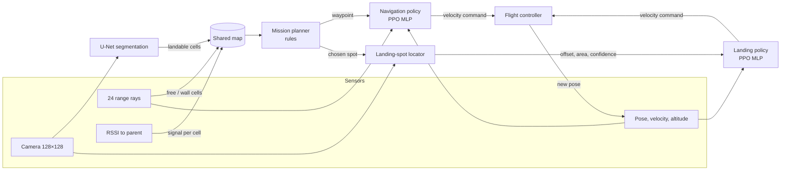
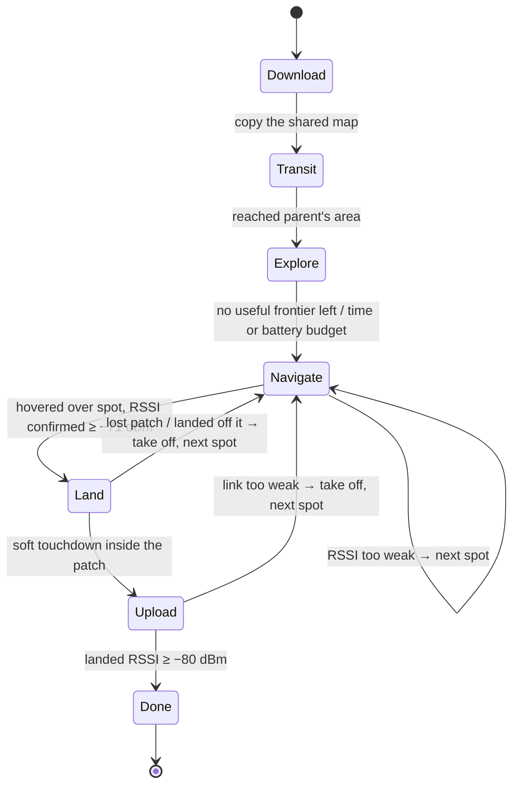
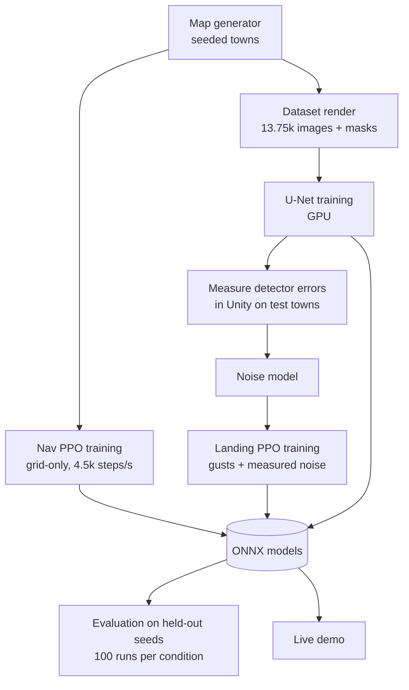

# How the Communication Drone simulation works

A walkthrough of the whole project: what runs, in what order, with what inputs and outputs, and why the drone does
what you see on screen. Read it top to bottom once; after that each section stands on its own for presenting.

---

## 1. The problem in one paragraph

A base station must give network coverage to a disaster camp on the other side of a collapsed town. Buildings block
WiFi, so there is no direct link. Drones are launched **one at a time**. Each flies out, finds a flat, safe spot that
still has a good signal back to the previous relay, **lands there** (a landed drone uses far less battery than a hovering
one) and becomes the next relay. The chain grows **base → drone 1 → drone 2 → … → camp** until the camp is covered.

Three subjects meet here:

| Subject | Its job in the project |
|---|---|
| **Drones** (control) | A simulated flight controller turns "fly at this velocity" into motion, like PX4/ArduPilot would |
| **Reinforcement learning** | Two learned skills: **fly to a point through unknown streets**, and **land precisely on a patch in wind** |
| **Machine vision** | Recognise **landable ground** from the camera, and **locate the landing patch** during descent |

Everything that *decides* (where to explore, where to land, when to stop) is a **hand-written planner**. RL only does
the *flying*. This split is deliberate: rules are easy to explain and verify; learning is used where rules are weak
(reacting to unknown obstacles, gusts and noisy detections).

---

## 2. Tech stack

| Layer | What | Why |
|---|---|---|
| Simulator / engine | **Unity 6** (6000.6.4f1), built-in render pipeline, C# | 3D rendering for the cameras, scripting for the whole sim |
| RL framework | **Unity ML-Agents 4.1** (C# side) + **mlagents 1.1.0** (Python, PyTorch 2.5) | Standard PPO trainer that talks to Unity over gRPC |
| RL algorithm | **PPO** (Proximal Policy Optimisation), continuous actions | Stable, well-understood on-policy algorithm |
| Vision model | **U-Net** written in **PyTorch**, exported to **ONNX** | Small, accurate per-pixel segmentation |
| In-sim inference | **Unity Inference Engine** (formerly Sentis), CPU backend | Runs the ONNX models (policies + U-Net) inside Unity |
| Hardware | i5-13400F, 32 GB RAM, RTX 3060 | CPU trains RL; GPU trains vision |
| Tooling | **uv** (Python env), **Unity MCP** (Claude Code ↔ Unity Editor), git | Reproducible environment, editor automation |

All scenes, maps and builds are created **from C# code** (editor scripts), never by hand.

---

## 3. The world (simulator)

### 3.1 The town
`MapGenerator.cs` creates a **seeded, procedural collapsed town** on a 1 m grid (96–120 m square):

- **Street grid** with irregular blocks and alleys.
- **Buildings** 8–20 m tall. Drones cruise at **5 m**, *below* the rooftops, so they must fly through streets like a
  maze (this is why flight is "2.5D": fixed cruise altitude, vertical motion only to land).
- **Collapsed buildings** and **rubble barriers** that block streets → dead ends and detours.
- **Ground surfaces**:
  - *Landable*: plaza paving, intact road strips, flat concrete.
  - *Look-alikes (not landable)*: cracked asphalt (most streets), debris fields, puddles, holes, wrecked cars, slopes.
- **Base station** on one edge, **camp** on the far side, usually with no line of sight between them.

Each map is stored as grids: **occupancy** (wall or free), **wall material** (concrete / brick / rubble), **ground type**.
The **same grid** drives the range sensors, collisions and WiFi; `TownBuilder.cs` turns it into the 3D scene with
textures for the cameras.

**Difficulty levels 1–4** (curriculum) change map size, rubble, how scarce landable spots are, and wind.

**Seeds**: training uses even seeds, all evaluations use odd seeds → every reported number is on maps never seen in training.

### 3.2 The WiFi model (`WifiModel.cs`)
Signal strength between two points:

```
RSSI = P0 − 10·n·log10(distance) − (wall losses) − (ground penalty if landed) + noise
```

| Parameter | Value | Meaning |
|---|---|---|
| P0 | −40 dBm | Power at 1 m |
| n | 2.0 | Path-loss exponent (open street canyon) |
| Wall loss | concrete 10 / brick 7 / rubble 5 dB **per wall**, 2 walls per building crossed | Line drawn between the two points through the grid |
| Ground penalty | 3 dB | A landed drone's antenna is lower |
| Noise | σ = 2 dB | Readings fluctuate |
| **T_link** | **−80 dBm** | Minimum usable link |
| Margin M | 6 dB | Safety margin |

Derived rules:
- A **landing spot qualifies** if measured RSSI to the parent ≥ T_link + M + ground penalty = **−71 dBm**
  (≈ 35 m with clear line of sight; one building in between makes it impossible).
- The **camp is covered** when the last relay gives it ≥ **−80 dBm** (≈ 100 m line of sight).

**Consequence you see on screen**: signal survives along a straight street but dies around a corner. So relays end up
at **corners and intersections**, where they can "see" down the next street.

### 3.3 Wind
Each episode/mission draws a **constant mean wind** plus **random gusts** (smooth pulses, 0.8–3 s long). Gusts push the
drone and are what make landing hard.

---

## 4. The drone and its flight controller (`FlightController.cs`)

RL never controls motors. Both policies output a **velocity command**, exactly like a companion computer talking to PX4:

```
SetVelocity(vx forward, vy sideways, vz up, yawRate)    limits: 3 m/s horizontal, 1 m/s vertical, 90°/s
```

Two physics models behind the same interface:

| Mode | Used for | What it simulates |
|---|---|---|
| **Fast** | RL training (millions of steps) | Velocity follows the command with a 0.26 s lag and acceleration limits; gusts push the drone |
| **Full** | Final evaluation, demo option | Real rigid-body quadrotor: 1.2 kg, 4 rotors with motor lag, drag. **Cascaded PID**: velocity error → desired tilt → body-rate → **mixer** → 4 rotor thrusts |

The fast mode was **tuned to match** the full mode (same settling time ≈ 0.84 s, same drift under a 3 m/s gust ≈ 0.38 m),
so policies trained fast still work on the full quadrotor (they lose 6–15 points of success, reported honestly).

Measured full-mode step response (forward speed 0 → 2 m/s): rise 0.54 s, overshoot 1 %, settling 0.83 s, max tilt 27°.

---

## 5. The control loop — what happens every 0.1 s

The whole simulation runs in **decision steps of 0.1 s** (10 Hz). Inside each step the physics integrates 5 sub-steps
of 0.02 s (fast mode) or 50 sub-steps of 0.002 s (full quadrotor).



Per step, depending on the mission mode:
1. **Sense**: cast 24 range rays, measure RSSI to the parent, every 3rd step render the camera and run the U-Net.
2. **Update the shared map** with what was sensed.
3. **Plan** (every 2 s or when a waypoint is reached): the planner picks the next waypoint or the landing spot.
4. **Act**: the navigation policy (cruising) or landing policy (descending) outputs a velocity command.
5. **Fly**: the flight controller integrates physics; collisions are checked against the grid.

---

## 6. The mission — rule-based planner (`DroneMission.cs`, `MissionRunner.cs`)

### 6.1 State machine per drone



| Mode (HUD) | What the drone does | Who flies | Vision |
|---|---|---|---|
| **TRANSIT** | Fly from the base to the previous relay along already-explored streets | Navigation policy | off |
| **EXPLORE** | Go to frontier cells to discover more streets and landing spots | Navigation policy | 45° camera, panning ±60° |
| **NAVIGATE** | Fly to the chosen spot, hover, re-measure RSSI | Navigation policy | 45° camera |
| **LAND** | Descend onto the spot | Landing policy | Nadir (straight down) camera |
| **UPLOAD** | Check the landed link, share the map | — | off |

### 6.2 The two key rules

**Where to explore (frontier rule).** A *frontier* is a known free cell next to unknown space. Among frontiers whose
signal to the parent is still ≥ **−74 dBm** (T_link + M), pick the one with the **shortest path distance to the camp**.
→ The drone pushes toward the camp but never wanders where it could not relay from.

**Where to land (spot rule).** Among cells the shared map believes are landable, keep those that:
1. have room for the drone (≥ 3 of 4 neighbours also landable),
2. have RSSI to the parent ≥ **−71 dBm** (measured if visited, otherwise predicted from known walls),
3. are **≥ 5 m closer** (by street path) to the camp than the parent,
4. are reachable;

then choose the one with the **shortest street-path distance to the camp** (ties: stronger signal).

→ **This is why a drone lands where it does**: it is the landable spot furthest along the route toward the camp that
still hears the previous relay clearly. In practice that is usually at or near a **corner**.

(Comparison: choosing a random qualifying spot reaches the camp 25 % of the time, the spot nearest the parent 3 %,
this rule 47 %.)

### 6.3 Shared map (`SharedMap.cs`)
A grid held at the base with: **explored**, **obstacle**, **landable evidence** (yes/no counts), **measured RSSI to the
current parent**, and the **list of relay positions**.
- Before launch a drone **downloads** a copy; after landing it **uploads** what it learned.
- A cell counts as landable only after **repeated, consistent** vision evidence (≥ 3 observations, ≥ 70 % saying landable).
- Effect: later drones explore **30 s instead of 52 s** because they start with earlier drones' knowledge.

### 6.4 Mission end
- **Success**: after a drone lands, if the last relay gives the camp ≥ −80 dBm.
- **Failure**: no qualifying spot exists, or 6 drones are used up. A crashed drone is replaced by the next one.
- Other limits per drone: battery 900 s of flight, exploration stops at 300 s or 50 % battery.

---

## 7. RL policy 1 — Navigation

**Task**: reach a waypoint (given by the planner) through streets it has never seen, using only onboard sensors. It
does **not** receive the map — that is the reason to use RL instead of a path planner.

### Input (33 numbers)
| Input | Count |
|---|---|
| Distance to waypoint (log-scaled) and bearing relative to heading | 2 |
| Velocity in body frame (forward, sideways) | 2 |
| Heading (sin, cos) | 2 |
| **Range-sensor ring**: 24 rays every 15°, up to 10 m, normalised | 24 |
| Previous action | 3 |

### Output (3 numbers, each −1…1)
Forward speed, sideways speed, yaw rate → scaled to 3 m/s, 3 m/s, 90°/s → flight controller.

### Network
MLP, **2 hidden layers × 256**, observation normalisation, no memory (LSTM not needed for point-to-point).

### Reward (per 0.1 s step)
| Term | Value |
|---|---|
| Progress along the **street path** to the waypoint (normalised so the full trip ≈ +1) | ≈ +1 total |
| Time cost | −0.0005 / step |
| Too close to a wall (< 1 m) | up to −0.02 / step |
| Jerky commands | −0.002 × (change in action)² |
| **Collision** (episode ends) | **−1** |
| **Waypoint reached** (< 1 m) | **+1** |

Why "street path" and not straight-line distance: progress is measured on a shortest-path field computed from the true
map **for the reward only** (the network never sees it). So flying *around* a wall is rewarded and pushing *into* it is
not — the policy learns to navigate the maze.

### Training
- PPO: lr 3e-4, batch 2048, buffer 32,768, γ 0.995, λ 0.95, clip 0.2, 3 epochs.
- **Curriculum** levels 1 → 4: waypoints 4–15 m away in open towns → 20–80 m in dense rubble with wind.
  Promoted when average reward passes a threshold.
- 32 arenas per Unity process, headless, grid-only (no 3D objects) → **~4,500 steps/s**.
- **10.75 M steps, ~35 minutes** of training.

### Results (held-out maps)
| Level | PPO | Potential field (same sensors) | Straight line | A* with full map (upper bound) |
|---|---|---|---|---|
| 1 | 98 % | 93 % | 84 % | 100 % |
| 2 | 98 % | 92 % | 64 % | 100 % |
| 3 | 93 % | 78 % | 39 % | 99 % |
| 4 | 80 % | 54 % | 18 % | 94 % |

**What you see on screen**: the drone turns to face open space, slides along streets, slows near walls and swings around
corners. The orange trail is its path.

---

## 8. RL policy 2 — Landing

**Task**: descend from cruise altitude onto the chosen patch, under gusts and imperfect detections. Without gusts and
noise a PID would be enough — the disturbances are why RL is used here.

### Input (10 numbers, from vision + sensors, never raw pixels)
| Input | Count |
|---|---|
| Patch centre offset in the camera image (x, y) | 2 |
| Patch apparent area (grows as it descends) | 1 |
| Detection confidence (0 when not seen) | 1 |
| Clearance: distance from patch centre to its edge | 1 |
| Altitude (rangefinder) | 1 |
| Velocity (body frame) | 3 |
| Frames since last detection | 1 |

### Output (3 numbers)
Forward speed, sideways speed (max 1.5 m/s), descent rate (max 1 m/s).

### Network
MLP, **2 hidden layers × 128**.

### Reward
| Term | Value |
|---|---|
| Horizontal offset from patch centre | −0.01 × metres / step |
| Descending too fast close to the ground | −0.05 × excess speed / step |
| Time cost, jerky commands | −0.002 / step, −0.002 × Δaction² |
| Shaping: Φ = −0.1·(altitude + 2·offset), reward = change in Φ | rewards "lower and more centred" |
| **Soft touchdown inside the patch** (≤ 0.6 m/s, drone fully inside) | **+1 + centring bonus (0–1)** |
| Off the patch, hard impact, patch lost > 3 s, flying away, timeout (40 s) | **−1** |

### Training history (honest)
- **v1** learned to **hover forever**: timing out cost −0.5 but a failed landing cost −1, so not landing was "safest".
- **v2** fixed it (timeout −1, added the shaping term): ~100 % success.
- **v3** fine-tuned v2 with the **detection noise measured from the real vision model** (missed detections, false
  detections, position error). This is the deployed landing policy.
- Gust curriculum 0 → 1.5 → 3 → 4.5 m/s.

### Results (held-out, 100 episodes each)
| Gust | PPO landing | PID baseline ("centre, then descend") |
|---|---|---|
| 0 m/s | 100 %, 1 cm error | 97 % |
| 3 m/s | 100 %, 2 cm | 76 % |
| 6 m/s (never trained) | 100 %, 5 cm | 44 % |

With **double** detection noise the PID drops to 0 % (it chases false detections) and PPO stays at 100 %.
On the full quadrotor at 3 m/s gusts: PPO 96 % (3 % hard touchdowns — it lands at ~0.5 m/s, close to the 0.6 m/s limit).

**What you see on screen**: mode switches to LAND, camera view turns to nadir, the drone leans into gusts, drifts back
over the green patch and slows down just before touching the ground.

---

## 9. Vision

### 9.1 Dataset (synthetic, auto-labelled) — `VisionDataset.cs`
- **13,750 images**, 128 × 128 RGB, from **125 generated towns** (levels 2–4).
- **Split by map**: 100 maps train (11,000), 10 val (1,100), 15 test (1,650) → test towns never seen.
- Camera poses: **55 % exploration view** (5 m altitude, 45° down, random heading) and **45 % landing view**
  (straight down, 0.6–6 m altitude, mostly over landable patches or look-alikes).
- **Labels for free**: each frame is rendered twice — once normally, once with every surface replaced by a **flat
  colour per class** and lighting off. The second render *is* the pixel-perfect mask.
- **Classes**: 0 unknown (sky / off-map), 1 **landable**, 2 **not landable**, 3 **obstacle** (buildings, rubble).
- **Domain randomisation** so the model does not memorise one look: ground colours and textures, dust tint, sun direction
  and strength, shadows, fog; during training also brightness/contrast/colour jitter, blur, sensor noise, mirror flips.

### 9.2 Model and training — `python/vision/train_seg.py`
- **U-Net**: encoder 16 → 32 → 64 → 128 channels (each 2 × [3×3 conv + BatchNorm + ReLU], max-pool),
  decoder with transposed convolutions and skip connections, 1×1 conv to 4 classes. **0.48 M parameters.**
- Loss: class-weighted cross-entropy (landable is rare) + 0.5 × Dice loss.
- AdamW, OneCycle learning rate (max 3e-3), batch 64, **40 epochs**, ~10 minutes on the RTX 3060.
- Exported to **ONNX** (softmax output), loaded in Unity by the Inference Engine.

### 9.3 Accuracy (test towns)
| Class | IoU |
|---|---|
| unknown | 0.955 |
| **landable** | **0.810** (precision 0.88, recall 0.91) |
| not landable | 0.927 |
| obstacle | 0.944 |
| **mean** | **0.909** |

For the ablation, deliberately weaker models were trained on 20 % of the maps (mean IoU 0.66) and 5 % (0.48).

### 9.4 How vision is used — two different jobs
**(a) Building the map while exploring** (`VisionSegmenter.cs`)
The 45° camera image is segmented; every 2nd pixel is **ray-cast onto the ground** using the known camera pose
(position, tilt, field of view 60°), giving which ground cell it shows. Landable / not-landable votes are added to that
cell in the shared map (up to 25 m away; pixels hidden behind buildings are dropped).
→ **On screen**: the minimap (top right) turns green where landable ground has been confirmed; the camera picture
(bottom right) shows the live segmentation overlay (green = landable, red = not, blue = obstacle).

**(b) Guiding the landing** (`LandingSpotLocator.cs`)
The straight-down image is segmented, landable pixels are grouped into connected regions, and the region **closest to
where the chosen spot should be** is picked. Output, every step: centre offset in the image, area, confidence, and how
far its centre is from an edge → these become the landing policy's inputs.
Measured on test towns: misses a visible patch 1.6 % of the time, median position error 0.44 m.

### 9.5 Noise model
For RL training we do not render cameras (too slow). Instead the true answer is corrupted with the **error rates measured
from the real detector** (missed / false detections, position error and bias, dropped frames). Same output format as the
real modules, so switching between them is one setting. The same noise model, scaled ×0 … ×8, produces the
**detector-quality** experiment.

---

## 10. Reading the live demo

Run: open `unity/Assets/Scenes/Demo.unity` → **Play** (or `Builds/Demo/Demo.x86_64`).

| Screen element | Meaning |
|---|---|
| Top-left HUD | Drone number and **mode**, **RSSI to parent** (must be ≥ −71 to land), **weakest link** of the chain, battery, detection confidence (landing), step reward, wind (GUST when a gust hits), relays landed / camp status |
| Yellow cylinder | Base station |
| Red box | Disaster camp |
| Orange drone | The drone currently flying; **orange line** = its path |
| Blue drones | Landed relays |
| **Coloured lines** between nodes | Radio links: **green = strong, yellow = near −80, red = broken** |
| Top-right minimap | Shared map: dark = unexplored, grey = explored street, slate = wall, **green = confirmed landable**, blue dots = relays, red = camp, yellow = current goal |
| Bottom-right picture | What the drone's camera sees + **live U-Net segmentation** (45° while exploring, nadir while landing) |
| Bottom-left panel | Map list and controls: 1–6 map, R restart, Space pause, +/− speed, C camera, **V real U-Net ↔ perfect vision**, H hide |

A typical run, narrated:
1. **Drone 1 / EXPLORE** — flies down the base's street; the minimap fills in; green appears where the camera finds landable
   ground. It goes no further than where RSSI to the base stays ≥ −74 dBm.
2. **NAVIGATE** — picks the landable spot closest (by street) to the camp that still has ≥ −71 dBm, hovers, re-measures.
3. **LAND** — camera switches to straight down; the landing policy centres over the patch against the wind and touches down.
4. **UPLOAD** — a green link line appears base → drone 1.
5. **Drone 2 / TRANSIT** — flies to drone 1 using the shared map (no re-exploring), then explores around the corner.
6. Repeat until the line from the last relay to the camp turns green: **TARGET COVERED**.

---

## 11. Training and evaluation pipeline



| What | Time | Steps / data |
|---|---|---|
| Navigation PPO | ~35 min (CPU) | 10.75 M steps |
| Landing PPO v2 + v3 | ~45 min (CPU) | 4.3 M + 3.7 M steps |
| U-Net | ~10 min (GPU) | 11,000 images × 40 epochs |
| Mission evaluation suite | ~75 min | ~20 conditions × 100 missions |

---

## 12. Headline results

| Experiment (held-out maps) | Result |
|---|---|
| Full mission, level 2, **real vision in the loop** | camp covered **34 %**, chain extended **+58 m** toward the camp, ~3 relays |
| Same with perfect vision | 43 %, +64 m |
| Vision quality sweep | reach holds up to ~2× the measured detector error, then collapses (0 m at 8×) |
| Shared map | later drones explore 30 s instead of 52 s |
| Spot rule vs random vs nearest | 47 % vs 25 % vs 3 % |
| RL navigation vs scripted reactive flight in missions | 47 % vs 9 % (scripted flight crashes 2.6 drones per mission) |

---

## 13. Known limitations (say these when presenting)

- WiFi is a simple **signal-strength proxy** (no reflections, interference or throughput).
- The **world was tuned** after early failures (intact-road strips added, path-loss and wall values adjusted) — documented in `PROGRESS.md`.
- Mission success is modest and drops on harder levels (level 4: 2 %). Most failures: **no landable spot** in the area
  that still hears the previous relay — the chain cannot turn a corner without one.
- Some demo maps succeed only marginally: tiny rendering differences (e.g. window size changing shadow detail) can change
  the outcome of a run.
- Simulation only; RL trained on the simplified flight model loses some performance on the full quadrotor.

---

## 14. Where things live

| Topic | Code | Results |
|---|---|---|
| Map, WiFi, path field | `unity/Assets/Scripts/Core/` | `docs/screenshots/maps/` |
| Flight controller | `unity/Assets/Scripts/Flight/FlightController.cs` | `docs/results/flight_*` |
| RL agents, baselines, evaluation | `unity/Assets/Scripts/RL/`, `configs/*.yaml` | `docs/results/nav_v1/`, `land/`, `training/` |
| Vision | `unity/Assets/Scripts/Vision/`, `python/vision/` | `docs/results/vision_unet_v2.*` |
| Mission planner, shared map, demo | `unity/Assets/Scripts/Mission/`, `World/DemoLevels.cs` | `docs/results/missions/`, `docs/demo/` |
| Full write-up | — | `docs/report.md`, `PROGRESS.md` |
